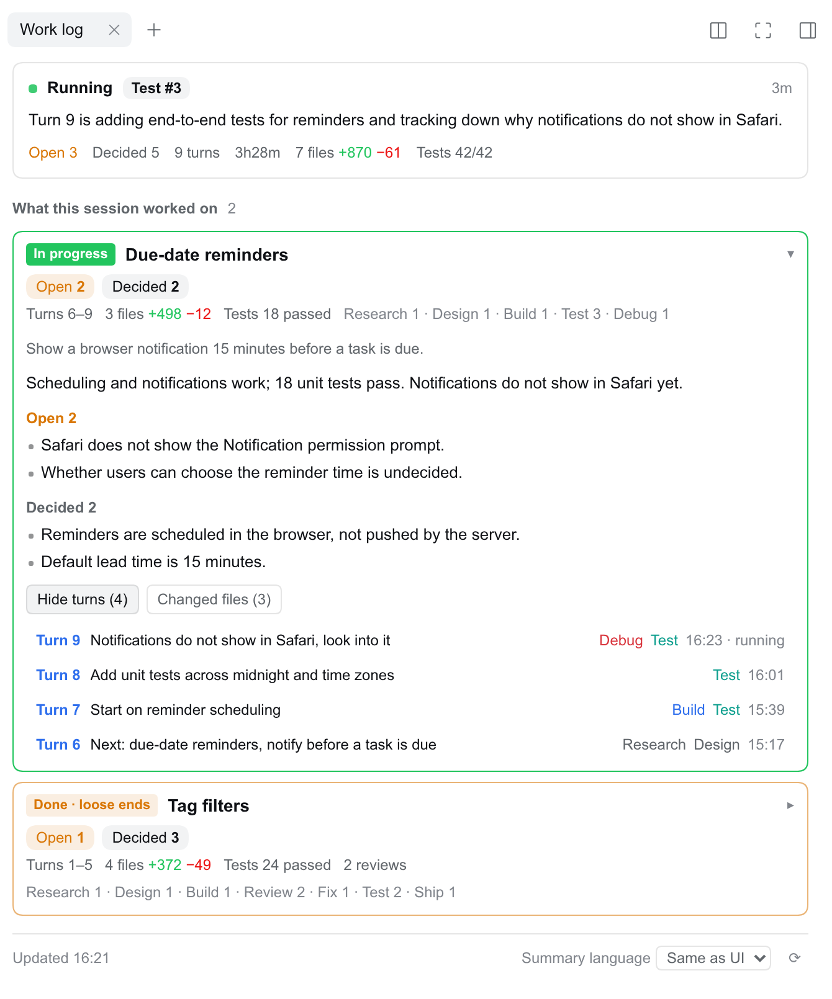

# dsh-session-journal

A [DeepSeek Harness (DSH)](https://github.com/deepseek-ai/deepseek-harness) Web plugin that keeps a **work journal** for each session in the right sidebar. Long sessions scroll away: requirements were discussed, code was written, reviewed three times, fixed and tested, and by then the start is far out of view. The journal shows what the session has worked on, where each piece of work stands, and lets you jump back to any turn in the chat.

[中文文档](README.zh.md)



## What you get

- **Now**: whether the session is running, the current phase (for example `Review #2`), a one-line status, and a highlighted "Your turn" box when the agent stopped to wait for you. Totals for the session: open items, decisions, turns, time, changed files and lines, tests passed.
- **Work items**: the session's turns grouped by purpose (one card per thing it worked on), not by time. Each card shows its status, the turns it covers, files and tests, and counts of what is still **open** and what was **decided**, so a card marked done with loose ends says so. Expanded, it shows the goal, the result, the open items, the decisions, and two lists:
  - **Jump to a turn**: one row per turn with what you asked and the phases it went through. Click a row to scroll the chat to the start of that turn (earlier history is loaded first when needed).
  - **Changed files**: file name, directory, lines added and removed, the phases that touched it. Click to open the file in the sidebar preview.
- **Header chip**: the current work item and phase next to the session title; click it to open the journal.
- English and Chinese UI, following the DSH language setting. The summary language is a separate choice in the panel footer: same as the UI, Chinese, or English.

## Usage

Open a session and pick **Work log** on the right sidebar's start page, or click the chip next to the session title. Expand a work item to see its open items and decisions; open **Jump to a turn** and click a row to scroll the chat to that turn. Change the summary language in the panel footer.

## How it works

Facts come from the session log; a model only labels and summarizes.

1. **Facts** (`lib/collector.js`): the plugin reads the session's append-only event log through DSH's `sessionQuery` service, so compacted history is still there. Per turn it extracts the user's message, every tool call, file edits with line counts, test commands and their exit codes, review delegations, questions to the user, and the todo list.
2. **Per-turn summaries** (`lib/summarizer.js`): each finished turn is summarized once by a model into phases (from a fixed list: requirements, research, design, build, review, fix, test, debug, ship, discussion), a short title and result per phase, the decisions made, and what was left open. Text the user pasted from elsewhere (another session's panel, logs, someone else's message) is treated as material, not as a request.
3. **Work items** (`lib/outline.js`): once every finished turn has a summary, one more call groups the turns into 1 to 6 work items and writes each item's status, result, open items and decisions. It sees the whole session, so problems solved in later turns do not linger as open. It is redone when the summaries change, which is about one call per new turn.
4. **When it updates** (`lib/autoupdate.js`): as soon as a session's turn ends, that session's journal is updated in the background: the finished turn is summarized, then the work items are regrouped. The plugin keeps checking that session every few seconds, as an open panel would, until nothing is left to do, so a failed summary is tried again after a minute (three attempts in all) without anyone opening the panel. It gives up after five minutes without progress, or thirty in total. Only the session whose turn ended is touched, in one summary language: the one it was last viewed in, else the language of its existing cache, else the language last viewed in the panel (remembered across restarts). Subagent and teammate sessions are skipped; their parent session records the delegation.
5. **Cache** (`lib/store.js`): summaries and the outline are stored per session and per summary language under `$DSH_HOME/storages/session-journal/`, so each turn is summarized once and switching languages back is instant.
6. **API** (`lib/webapi.js`): `GET /plugins/session-journal/api/journal?session=<id>&lang=zh|en`, behind DSH's login check. The browser polls it every 4 s while the session runs or summaries are pending, every 20 s otherwise.

Without a model the journal still works: phases come from rules (edits, tests, reviews) and the whole session is one work item.

## Model and cost

By default each session is summarized with **that session's own provider and model**. Summary calls are separate requests with their own small context; they never touch the conversation or its cache. Costs, roughly: one call per finished turn (a few thousand input tokens), and one outline call per new turn (5k to 20k input tokens on long sessions). In the background, only sessions that are being worked on cost anything; idle sessions are not touched (opening the panel on one still summarizes any turns it lacks). The first turn to end after installing or upgrading the plugin also summarizes that session's earlier turns that have no summary yet, and so does the first turn of a forked session, for the turns it inherited.

To use one fixed, usually cheaper, model for every session, set both `SESSION_JOURNAL_PROVIDER` and `SESSION_JOURNAL_MODEL` in DSH's launch environment (for example `$DSH_HOME/.env`); setting only one of them has no effect:

```bash
SESSION_JOURNAL_PROVIDER=<provider id>
SESSION_JOURNAL_MODEL=<model id>
SESSION_JOURNAL_EFFORT=low        # reasoning effort; "default" leaves it to the route
# SESSION_JOURNAL_MODEL=off       # no model calls, rules only
```

Restart DSH after changing them.

## Jumping to a turn

DSH has no public "scroll to turn" API for plugins. The chat view has its own turn rail, a row of ticks at the right edge of the transcript, one per turn. The journal finds the tick for the turn and clicks it, so the chat does the scrolling and any history loading itself.

- This relies on the chat view's markup, not on a contract. If a DSH update changes the rail, clicking a turn shows a note instead of jumping; nothing else breaks.
- The rail hides itself when the chat column is narrower than 900px, which is normal with the right sidebar open. The journal renders it invisibly for the moment of the click and then hands it back.
- The main area must show the Chat view. On other views the journal asks you to switch back first.

## Requirements

DSH `>=0.2.2-alpha.2 <0.3.0-0` (0.2.x, including its prereleases), Node `>=22.19`.

## Install

```bash
dsh plugin --profile web add github:Edison-A-N/dsh-session-journal
```

The package ships its own bundle patch (`dsh.bundle.patch` + `cordis.patch.yml`), so the CLI and the Web UI's Plugins page load it in one step. Restart DSH, reload the page, open a session, and pick **Work log** on the right sidebar's start page (or click the chip in the session header).

## Known limitations

- Grouping into work items is done by a model and is not always how you would split the work; for example a release step may come out as its own item.
- While a turn is running, a work item's open items can lag one turn behind; they catch up when the turn ends and is summarized.
- Files outside the session's workspace are listed but cannot be previewed in the sidebar.
- The first time you open a long session that has no cache yet, summarizing every turn takes a minute or two. Until then the panel shows rule-based phases.

## Development

```bash
pnpm install
pnpm run build   # bundles client/src into lib/client.js
pnpm test
```

`lib/client.js` is committed, because DSH loads it as-is; rebuild it in the same commit as any change under `client/src`.

Bug reports and pull requests are welcome on [GitHub](https://github.com/Edison-A-N/dsh-session-journal/issues). Please include the DSH version, the browser, and what the panel showed.

## License

[MIT](LICENSE).
