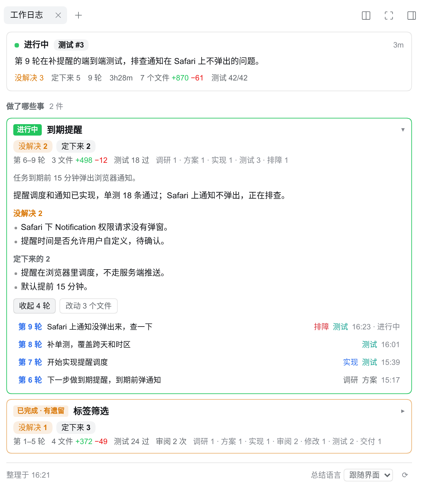

# dsh-session-journal

[DeepSeek Harness（DSH）](https://github.com/deepseek-ai/deepseek-harness) 的 Web 插件，在右侧栏给每个会话记一本**工作日志**。长会话里，聊需求、写代码、review 三轮、修改、测试，做到后面，开头早就滚出屏幕了。工作日志列出这个会话做了哪几件事、每件做到哪了，还能一键跳回对话里的任意一轮。

[English](README.md)



## 功能

- **现状卡**：会话是否在跑、当前阶段（例如「审阅 #2」）、一句话现状。agent 停下来等你时，显示醒目的「等你」，写明在等什么。下面是整个会话的合计：没解决几条、定下来几条、轮数、耗时、改动的文件和行数、测试通过数。
- **工作项**：按目的把轮次归成几件事，每件一张卡片，不按时间排。卡片上有状态、覆盖哪几轮、文件和测试数，还有「没解决」和「定下来」各几条。标了已完成但还有遗留的，卡片会写「已完成 · 有遗留」。展开后是目标、结果、没解决的事、定下来的决定，以及两个列表：
  - **按轮跳转**：每轮一行，写着你这一轮说了什么、经历了哪些阶段。点一行，对话就滚到那一轮的开头；那一轮还没加载时，先加载更早的历史。
  - **改动的文件**：文件名、目录、增删行数、改过它的阶段。点一下在右栏预览。
- **顶栏标签**：会话标题旁显示当前在做的事和阶段，点它打开工作日志。
- 界面有中文和英文，跟随 DSH 的语言设置。总结用哪种语言在面板底部单独选：跟随界面、中文或 English。

## 使用

打开一个会话，在右侧栏开始页选「工作日志」，或者点会话标题旁的标签。展开一件事，能看到没解决的事和定下来的决定；点「按轮跳转」再点其中一行，对话会滚到那一轮。总结语言在面板底部切换。

## 工作原理

事实从会话日志里取，模型只负责归类和总结。

1. **取事实**（`lib/collector.js`）：通过 DSH 的 `sessionQuery` 服务读会话的事件日志。日志只追加不删除，压缩过的历史也在。每一轮取出用户消息、每次工具调用、文件改动和增删行数、测试命令和退出码、交给子 agent 的审阅、向用户的提问、待办列表。
2. **逐轮总结**（`lib/summarizer.js`）：每一轮结束后让模型总结一次。分出阶段（从固定的几类里选：需求、调研、方案、实现、审阅、修改、测试、排障、交付、讨论），每个阶段一句标题和结果，再列出定下来的事和没做完的事。用户从别处贴进来的内容（别的会话的面板、日志、别人的消息）当作材料，不当作请求。
3. **归成工作项**（`lib/outline.js`）：所有已完成的轮次都有总结后，再调用一次模型，把轮次归成 1 到 6 件事，写出每件的状态、结果、没解决的事和决定。这一步看的是整个会话，后面已经解决的问题不会留在「没解决」里。总结有变化就重新整理，大约每新增一轮调用一次。
4. **缓存**（`lib/store.js`）：总结和工作项按会话、按总结语言存在 `$DSH_HOME/storages/session-journal/` 下。每一轮只总结一次，语言切回来也不用重算。
5. **接口**（`lib/webapi.js`）：`GET /plugins/session-journal/api/journal?session=<id>&lang=zh|en`，经过 DSH 的登录校验。会话在跑或总结没做完时，浏览器每 4 秒取一次，其余时候每 20 秒一次。

不配模型也能用：阶段按规则划分（改文件、跑测试、审阅），整个会话算作一件事。

## 模型与开销

默认用**每个会话自己的 provider 和模型**来总结。总结是单独的请求，上下文很小，不进对话，也不影响对话的缓存。开销大致是：每结束一轮调用一次，输入几千 token；每新增一轮再整理一次工作项，长会话输入 5k 到 20k token。

想给所有会话统一用一个模型（通常是更便宜的小模型），在 DSH 的启动环境里同时设置 `SESSION_JOURNAL_PROVIDER` 和 `SESSION_JOURNAL_MODEL`，例如写进 `$DSH_HOME/.env`。只设其中一个不生效：

```bash
SESSION_JOURNAL_PROVIDER=<provider id>
SESSION_JOURNAL_MODEL=<model id>
SESSION_JOURNAL_EFFORT=low        # 推理强度；写 default 则交给路由自己的默认值
# SESSION_JOURNAL_MODEL=off       # 不调用模型，只按规则整理
```

改完重启 DSH。

## 跳到某一轮

DSH 没有给插件开放「滚动到某一轮」的接口。对话页右边自带一条轮次导航，每一轮一个小刻度。工作日志找到那一轮的刻度替你点一下，滚动和加载历史都由对话页自己完成。

- 这依赖对话页的页面结构，不是正式接口。DSH 升级后如果导航条变了，点轮次会提示无法跳转，其他功能不受影响。
- 对话区宽度不到 900px 时，导航条会自动隐藏，打开右栏时通常就是这样。跳转时插件临时把它渲染出来（不显示），点完再交还给页面样式。
- 主区域要停在「对话」页。在其他页时会提示你先切回对话页。

## 使用前提

DSH `>=0.2.2-alpha.2 <0.3.0-0`（0.2.x，含预发布版本），Node `>=22.19`。

## 安装

```bash
dsh plugin --profile web add github:Edison-A-N/dsh-session-journal
```

包里自带 bundle patch（`dsh.bundle.patch` 加 `cordis.patch.yml`），命令行和 Web 界面的「插件」页都能一步装好。重启 DSH，刷新页面，打开一个会话，在右侧栏开始页选「工作日志」，或者点会话顶栏上的标签。

## 已知限制

- 工作项由模型分组，不一定和你自己的划分一致。比如发布上线有时会被单独分成一件事。
- 某一轮还在跑时，工作项的「没解决」可能落后一轮，等这一轮结束、总结完会跟上。
- 工作区以外的文件会列出来，但不能在右栏预览。
- 第一次打开一个没有缓存的长会话，要逐轮总结一遍，大约一两分钟。在此之前面板按规则显示阶段。

## 开发

```bash
pnpm install
pnpm run build   # 把 client/src 打包成 lib/client.js
pnpm test
```

`lib/client.js` 提交在仓库里，因为 DSH 直接加载它。改了 `client/src` 就在同一个提交里重新构建。

欢迎在 [GitHub](https://github.com/Edison-A-N/dsh-session-journal/issues) 提问题和 PR。请写上 DSH 版本、浏览器，以及面板上显示的内容。

## 许可证

[MIT](LICENSE)。
